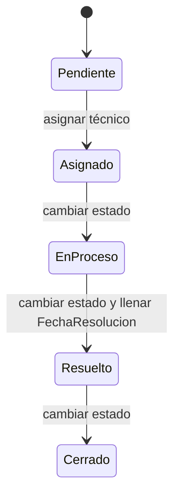

# Análisis del caso TechSupport

Este documento responde el análisis de la guía: los cuatro problemas del caso, el ciclo de estados del incidente y las decisiones que la API implementa. Cada decisión indica por qué se tomó y qué pasaría si no se aplicara.

## A1. Problemas del caso

| Problema | Requerimiento | Prueba |
| --- | --- | --- |
| Las solicitudes se pierden entre cientos de mensajes, porque el pedido queda en un chat que se desplaza y nadie puede recuperarlo después. | Cada solicitud se persiste como un incidente en SQLite mediante `POST /api/incidentes` y se recupera con `GET /api/incidentes`. Se guarda en el archivo de base de datos, y no en la memoria del proceso, porque al cerrar la API el archivo sigue en disco. Si no se persistiera, reiniciar el servicio borraría los casos y el problema original seguiría igual. | Se crea un incidente con `POST /api/incidentes` y, sin enviarlo otra vez, `GET /api/incidentes` lo devuelve leyendo el mismo archivo SQLite. Si el alta solo viviera en memoria, ese listado después de reiniciar la API no lo mostraría. |
| Las asignaciones son poco claras: dos técnicos toman el mismo caso y otro problema queda sin atender, porque no hay una sola persona responsable de decidir quién lo trabaja. | Solo un administrador puede llamar a `PUT /api/incidentes/{id}/asignar`, y solo hacia un usuario con rol Tecnico. Al asignar, el incidente pasa de Pendiente a Asignado y queda con ese `TecnicoId`. Si cualquier rol pudiera asignar, o si se aceptara a alguien que no es técnico, el caso seguiría sin un dueño válido o lo tomarían dos personas a la vez. | Asignar a un usuario que no tiene rol Tecnico, o asignar un incidente que no está Pendiente, responde 400 y no cambia el estado. El listado de un técnico responde 200 y trae solo las filas cuyo `TecnicoId` es el suyo, así que no ve como propio un caso que no le asignaron. |
| Algunos empleados consultan información que no es suya, porque un identificador conocido bastaría para leer el título, la descripción y quién lo atiende. | El listado y el detalle se filtran con la matriz de la guía: el administrador ve todos, el técnico solo los que tiene asignados y el usuario solo los que él creó. El detalle fuera de ese alcance responde 404 con el mismo cuerpo que un id inexistente: «Incidente no encontrado.». El listado no usa 404: responde 200 solo con las filas de ese rol. Si el detalle ajeno devolviera el incidente, cualquier empleado leería casos de los demás. | Un usuario autenticado hace `GET /api/incidentes/{id}` con el id de un incidente creado por otra persona y recibe 404 con «Incidente no encontrado.», el mismo cuerpo que si ese id no existiera. |
| Cuando ocurre un error nadie sabe qué pasó, y si la API muestra el detalle interno un tercero ve la traza, la ruta del servidor o el nombre de la base. | `ExceptionHandlingMiddleware` registra la excepción completa con `ILogger` y responde 500 con `success` en false, el mensaje genérico «Ocurrió un error al procesar la solicitud.», `requestId` igual a `HttpContext.TraceIdentifier` y `timestamp`. El cliente recibe ese aviso para poder reportar el caso, y el operador busca el mismo `requestId` en el log, donde sí está la excepción. Si no se registrara, el identificador de la respuesta no tendría contra qué compararse. Si el cuerpo incluyera la traza, se filtrarían datos internos. Un 400, un 403 o un 404 de regla de negocio no pasa por ese JSON, porque el cliente debe poder distinguir un rechazo previsto de una falla no controlada. | Una excepción no controlada responde ese JSON de 500 y no incluye traza de pila, ruta del servidor ni nombre de la base de datos. El `requestId` de esa respuesta se encuentra en el registro del servidor. |

## A2. Ciclo de estados

El incidente solo avanza. Cada flecha es la única transición aceptada desde ese estado.

Pendiente nace al crear el incidente. La única salida de Pendiente hacia Asignado es la asignación (`PUT /api/incidentes/{id}/asignar`), no el endpoint de estado. Ese endpoint solo acepta el estado siguiente cuando el incidente ya tiene técnico: Asignado pasa a EnProceso, EnProceso pasa a Resuelto y Resuelto pasa a Cerrado. Al entrar en Resuelto se llena `FechaResolucion`, porque ese es el momento en que el caso queda resuelto.

Saltar un paso se rechaza con 400. No se puede cerrar sin resolver: desde EnProceso no se acepta Cerrado, porque faltaría Resuelto y `FechaResolucion` quedaría vacía. Retroceder tampoco se acepta. La transición prohibida de forma explícita es reabrir un incidente Cerrado. Si el mismo problema vuelve a ocurrir, se crea un incidente nuevo, que nace en Pendiente y vuelve a pasar por asignación.

Por qué el ciclo es solo hacia adelante: cada estado deja constancia de que el paso anterior ya ocurrió, y `FechaResolucion` significa el cierre de un solo caso. Qué pasaría si no: un incidente podría quedar Cerrado sin técnico y sin fecha, dos atenciones distintas compartirían el mismo historial, o el endpoint de estado marcaría Asignado con `TecnicoId` vacío y otra vez nadie sabría quién lo atiende.

## A3. Decisiones

### Consultar un incidente que no corresponde responde 404

Si quien llama no puede ver ese incidente, la API responde 404 con el mismo cuerpo que un id que no existe: «Incidente no encontrado.». La misma regla vale para el detalle y para un técnico que intenta cambiar el estado de un incidente que no tiene asignado. El listado no sigue esta regla: responde 200 y devuelve solo las filas que ese rol puede ver. Un rol que no puede ejecutar la operación, como un técnico que intenta eliminar o un usuario que intenta asignar, recibe 403 desde `[Authorize]`, antes de buscar el id.

**Por qué.** El 404 no confirma que el id exista, así que un atacante no puede enumerar incidentes probando números. El 403 de `[Authorize]` se reserva para una capacidad que ese rol no tiene en ningún incidente. Como el técnico recibe 403 en todo `DELETE`, ese código no revela si el id era real. El listado en 200 con el subconjunto permitido responde «esto es lo tuyo» sin decir cuántos casos ajenos hay.

**Qué pasaría si no.** Un 403 en el detalle de un id ajeno revelaría que ese incidente sí existe. Quien pruebe ids seguidos armaría el inventario de casos que no le corresponden. Si el listado respondiera 404 al haber incidentes ocultos, el cliente también sabría que existen filas que no puede ver. Si el 403 y el 404 se intercambiaran, un técnico no distinguiría «no puedes borrar» de «ese caso no es tuyo», y la matriz de permisos dejaría de leerse en el código de respuesta.

### El administrador sí puede eliminar un incidente Cerrado

La matriz de la guía otorga el borrado al administrador y no pone ninguna excepción por estado. `DELETE /api/incidentes/{id}` lo ejecuta también cuando el incidente está Cerrado.

**Por qué.** El permiso y el estado son reglas distintas. El estado dice en qué punto del ciclo está el caso. El rol dice quién puede borrarlo. Como la matriz no condiciona el delete al estado, bloquear Cerrado sería inventar una restricción que la guía no pide.

**Qué pasaría si no, y qué se pierde al permitirlo.** Si el delete se bloqueara en Cerrado, la implementación contradiría la matriz de la guía. El costo de permitirla es que el historial desaparece: se pierden el título, la descripción, el técnico, las fechas y la traza de cómo se resolvió. Después del borrado ya no se puede reconstruir quién lo resolvió ni cuándo. Esa pérdida es el precio de respetar la matriz, y queda aceptada a propósito.

### Notas de la guía

El login usa el mismo 401, «Credenciales inválidas.», para un usuario desconocido y para una contraseña incorrecta, porque un mensaje distinto le diría a un atacante qué nombres de usuario existen.

Si `ExceptionHandlingMiddleware` se registrara al final, no atraparía las excepciones de los middleware anteriores (autenticación, HTTPS y enrutamiento), porque esos se ejecutan fuera de su try/catch.
